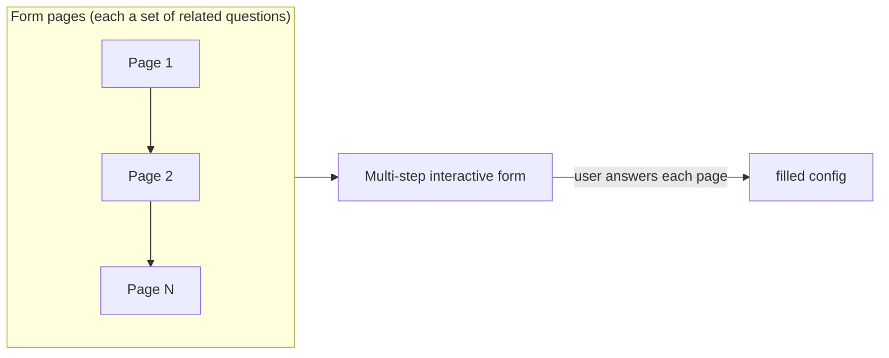
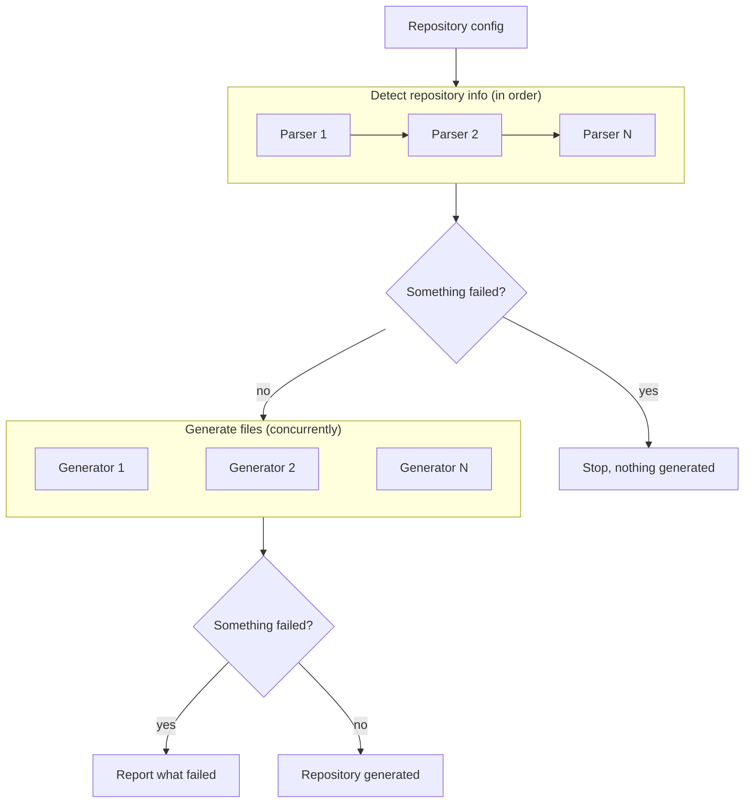
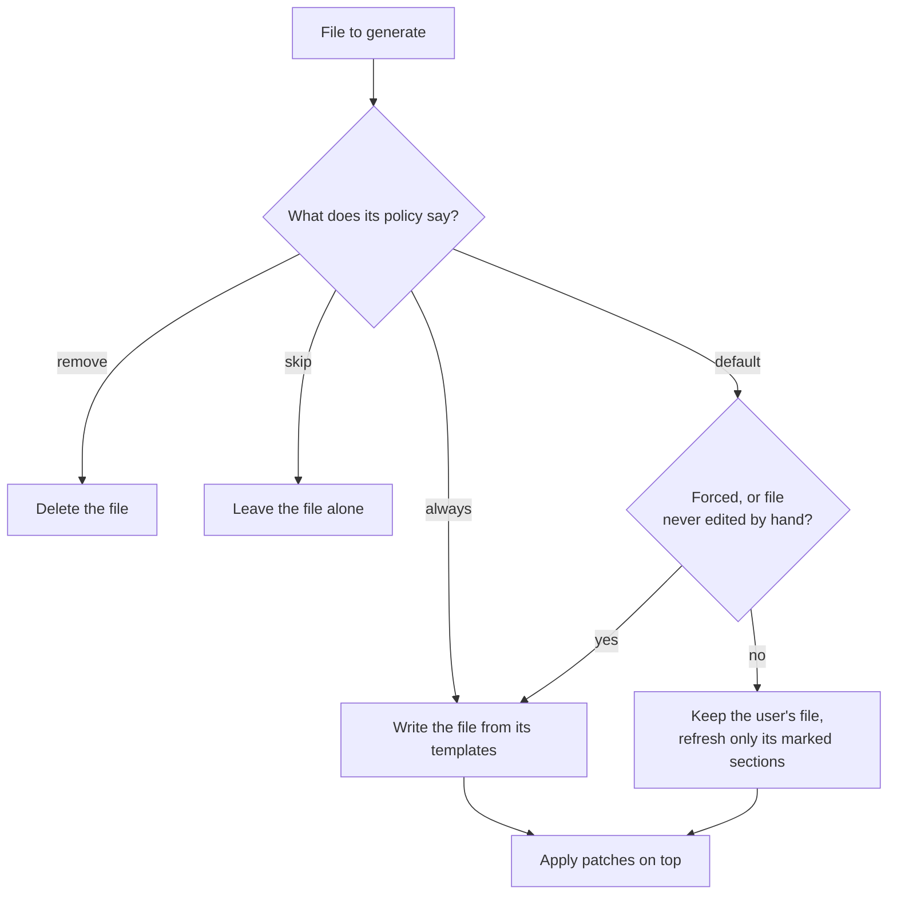

# engine <!-- omit in toc -->

<div align="center">

<!-- BEGIN_KICKR_BADGES -->
[](https://gitlab.com/kickr-dev/engine/-/releases)
[](https://gitlab.com/kickr-dev/engine/-/work_items)
[](https://gitlab.com/kickr-dev/engine/-/blob/HEAD/LICENSE)
[](https://gitlab.com/kickr-dev/engine/-/pipelines?ref=main)
[](https://gitlab.com/kickr-dev/engine/-/blob/HEAD/go.mod)
[](https://score.getplumber.io/gitlab.com/kickr-dev/engine)
<!-- END_KICKR_BADGES -->

</div>

---

- [How to use?](#how-to-use)
- [Initialize (pkg.go.dev)](#initialize-pkggodev)
- [Generate (pkg.go.dev)](#generate-pkggodev)
  - [Templates](#templates)
- [Helpers](#helpers)

A Go library to build projects scaffolding CLIs on three main features:
- [**Initialization**](#initialize-pkggodev): interactive user configuration with [**huh**](https://github.com/charmbracelet/huh) (*e.g.* license choice, maintainers list, etc.)
- [**Parsing**](#helpers): repository languages parsing
- [**Generation**](#generate-pkggodev): repository scaffolding with files generation based on Go template

## How to use?

```sh
go get -u github.com/kickr-dev/engine@latest
```

## Initialize ([pkg.go.dev](https://pkg.go.dev/github.com/kickr-dev/engine/pkg))

Runs an interactive form with [**huh**](https://github.com/charmbracelet/huh)
and alters the created configuration gradually with each `huh.Group`.



## Generate ([pkg.go.dev](https://pkg.go.dev/github.com/kickr-dev/engine/pkg))

Parses a repository with all its configured parsers
and then runs all generators to create the appropriate files regarding the repository configuration, technologies, languages, etc.



### Templates

Each file has a policy. It can be rewritten every time, removed or left alone,
but by default it's rewritten only while nobody has edited it by hand.



## Helpers

- [`pkg/files`](https://pkg.go.dev/github.com/kickr-dev/engine/pkg/files):
  read, write, validate (JSON schema) and glob files.
- [`pkg/generator`](https://pkg.go.dev/github.com/kickr-dev/engine/pkg/generator):
  fetch `.gitignore`, code of conduct and pinned container images.
- [`pkg/parser`](https://pkg.go.dev/github.com/kickr-dev/engine/pkg/parser):
  detect Git, Go (`go.mod`, `go.work`, `cmd`), Hugo and `package.json`.
